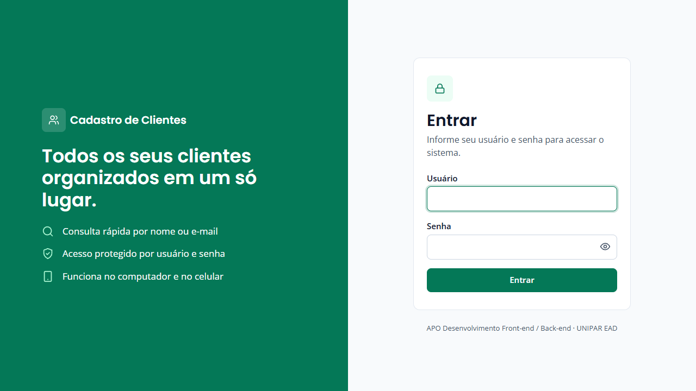
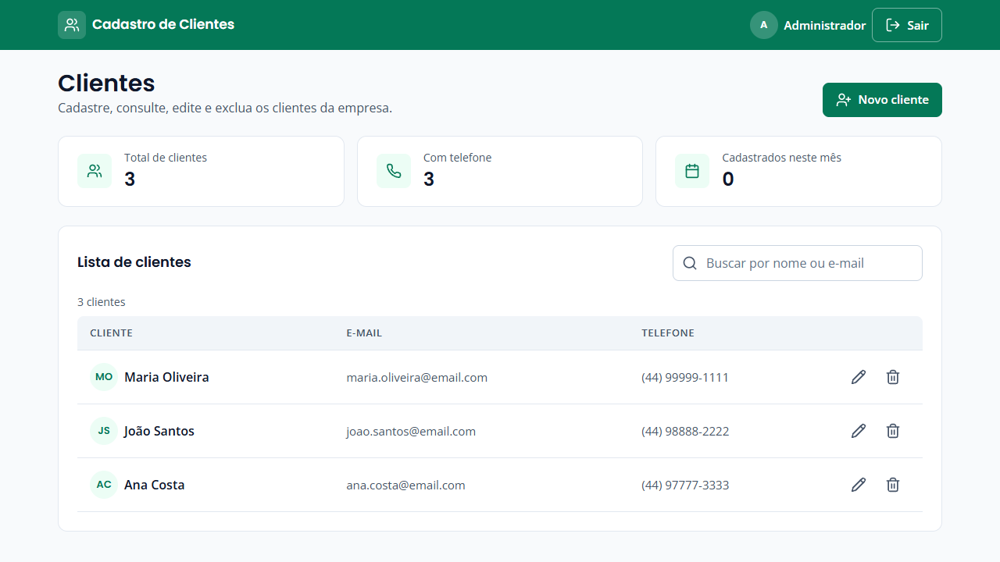
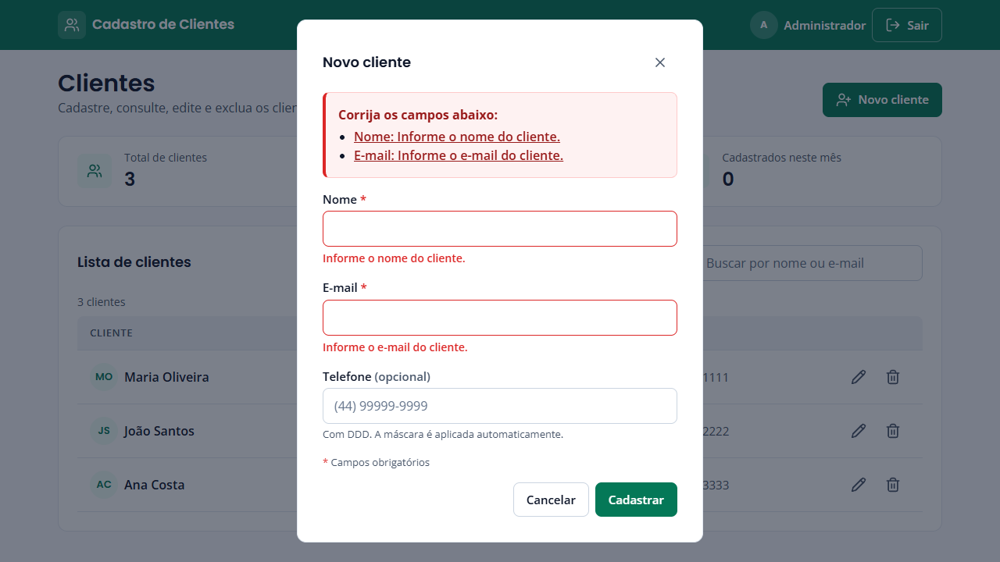
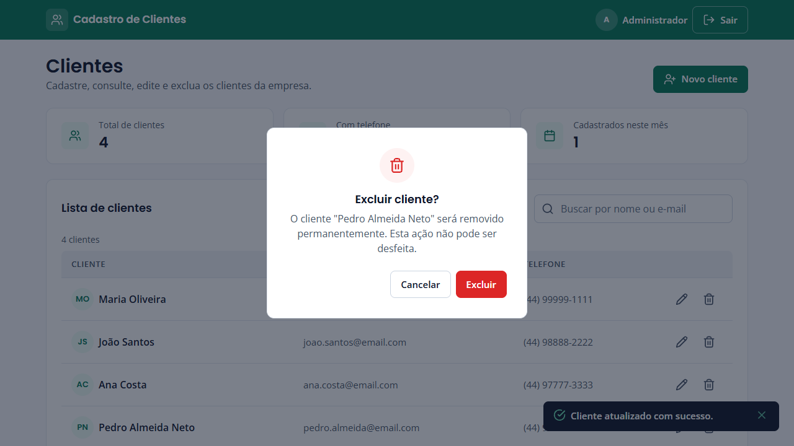
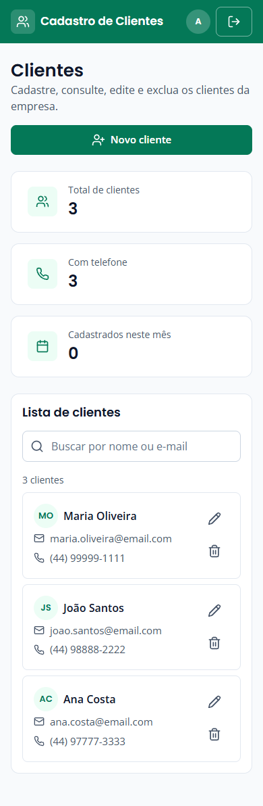

# Cadastro de Clientes – CRUD (Front-end + Back-end)

Aplicação web para uma pequena empresa cadastrar e gerenciar seus clientes, desenvolvida para a
**Atividade Prática Orientada (APO) – Desenvolvimento Front-end / Back-end** (UNIPAR EAD, Prof. Allan da Silva).

**Aluno:** Henrique Ribeiro de Souza – RA 09058211 – Sistemas de Informação

O acesso é protegido por **login com usuário e senha**. Depois de entrar, o sistema permite
**listar, consultar, cadastrar, editar e excluir** clientes. O front-end (HTML, CSS e
JavaScript puro) se comunica com uma **API REST** feita em **Node.js + Express.js** por meio de requisições
HTTP com `fetch()`, trocando dados em **JSON**. Os registros ficam salvos no arquivo `backend/data/clientes.json`.

| Login | Clientes |
|---|---|
|  |  |
| **Validação do formulário** | **Confirmação de exclusão** |
|  |  |

<p align="center"></p>

## Início rápido

```bash
git clone https://github.com/<seu-usuario>/crud-clientes.git
cd crud-clientes/backend
npm install
npm start
```

Abra **http://localhost:3001** e entre com **admin** / **admin123**.
Na primeira execução o sistema cria esse usuário e carrega 3 clientes fictícios automaticamente.

## Tecnologias utilizadas

| Camada | Tecnologia | Uso no projeto |
|---|---|---|
| Front-end | HTML5 | Estrutura semântica da página, formulário e tabela |
| Front-end | CSS3 | Layout responsivo *mobile first* (Flexbox, Grid, media queries) |
| Front-end | JavaScript (ES2020+) | Manipulação do DOM, eventos, validação e `fetch()` assíncrono |
| Back-end | Node.js 18+ (testado no 24 LTS) | Ambiente de execução do servidor |
| Back-end | Express.js 4 | Rotas, middlewares, JSON e arquivos estáticos |
| Back-end | cors, dotenv | Liberação de origem cruzada e variáveis de ambiente |
| Dados | Arquivo JSON (`fs/promises`) | Persistência simples sem banco de dados |
| Segurança | `crypto` (scrypt) + token Bearer | Hash de senhas e sessões de login |
| Design | Skill **ui-ux-pro-max** | Design system (cores, tipografia, componentes, checklist de UX) |
| Testes | `node:test` + `api.http` | Testes automatizados e manuais da API |
| CI | GitHub Actions | Executa `npm test` no Node.js 20, 22 e 24 a cada envio |

## Interface (design system)

A interface foi recriada com a skill **ui-ux-pro-max**, que gerou o design system salvo em
[`design-system/cadastro-de-clientes/MASTER.md`](design-system/cadastro-de-clientes/MASTER.md):

- **Estilo:** Flat Design: bordas em vez de sombras, cores sólidas e transições curtas (150–200 ms).
- **Cores:** verde `#047857` como cor principal (contraste 5,5:1 com branco, WCAG AA), fundo `#F8FAFC`,
  texto `#0F172A` e vermelho `#DC2626` para ações destrutivas. A skill sugeriu azul para CRMs; o verde
  foi mantido por escolha do usuário.
- **Tipografia:** Poppins nos títulos e Open Sans no texto (Google Fonts, com fonte do sistema como alternativa).
- **Ícones:** SVG do conjunto Lucide (sem emojis).
- **UX aplicada:** formulário em diálogo modal, erro abaixo de cada campo (`aria-describedby`) e resumo
  de erros focável, validação ao sair do campo, confirmação de exclusão acessível com foco na opção
  segura, avisos (toasts) que somem sozinhos, esqueleto de carregamento, estados vazios com ação,
  área mínima de toque de 44 px, foco visível, link "Pular para o conteúdo" e respeito a
  `prefers-reduced-motion`.
- **Layout:** *mobile first* testado em 390 px (tabela vira cartões, sem rolagem horizontal), 768 px e 1280 px;
  na tela de login em telas grandes, um painel de apresentação ocupa a metade esquerda.

## Estrutura

```
crud-clientes/
├── backend/
│   ├── src/
│   │   ├── server.js                     # inicia o servidor (lê o .env)
│   │   ├── app.js                        # middlewares, rotas, estáticos, tratamento de erros
│   │   ├── routes/                       # clientes.routes.js, auth.routes.js
│   │   ├── controllers/                  # requisição/resposta e status HTTP
│   │   ├── services/                     # validações, regras de negócio e autenticação
│   │   ├── middlewares/autenticar.js     # exige token válido nas rotas de clientes
│   │   └── repositories/                 # leitura/escrita dos arquivos JSON
│   ├── data/clientes.exemplo.json        # clientes fictícios da primeira execução
│   │   (clientes.json e usuarios.json são criados ao rodar e não vão para o Git)
│   ├── scripts/criar-usuario.js          # cria usuário ou troca senha
│   ├── tests/clientes.test.js            # testes automatizados
│   ├── api.http                          # requisições para testes manuais
│   ├── .env.example
│   └── package.json
├── frontend/
│   ├── login.html                        # tela de login
│   ├── index.html                        # tela de clientes
│   ├── css/style.css                     # tokens e componentes do design system
│   └── js/
│       ├── api.js                        # chamadas fetch, sessão e modo simulado
│       ├── login.js                      # validação e envio do login
│       └── app.js                        # listagem, diálogos, validação, avisos
├── design-system/cadastro-de-clientes/MASTER.md  # gerado pela skill ui-ux-pro-max
├── docs/
│   ├── screenshots/                      # imagens usadas neste README
│   └── roteiro-video-aula.md             # cronograma da videoaula explicando o código
├── .github/workflows/testes.yml          # testes automáticos no GitHub Actions
├── iniciar.bat                           # executa tudo com duplo clique (Windows)
├── LICENSE                               # licença MIT
└── README.md
```

## Como executar

Pré-requisito: [Node.js](https://nodejs.org) 18 ou superior.

### Opção 1 – Duplo clique (Windows)
Execute `iniciar.bat`. Ele instala as dependências na primeira vez, verifica se a porta está livre,
inicia a API e abre `http://localhost:3001` no navegador.

### Opção 2 – Terminal

```bash
cd backend
npm install
cp .env.example .env     # opcional; no Windows: copy .env.example .env
npm start
```

### Login

Usuário inicial: **admin** · senha: **admin123**

Para criar outro usuário ou trocar a senha de um existente:

```bash
cd backend
npm run criar-usuario -- <usuario> <senha> "Nome completo"
# exemplo: npm run criar-usuario -- admin NovaSenha2026 "Administrador"
```

As senhas não ficam salvas em texto: o arquivo `backend/data/usuarios.json` guarda apenas o hash
(`scrypt` com *salt* aleatório). Após o login, a API devolve um token de sessão (válido por 8 horas),
que o front-end envia no cabeçalho `Authorization: Bearer <token>`. O token fica no `sessionStorage`
e é descartado ao clicar em **Sair** ou fechar o navegador. Reiniciar o servidor encerra todas as sessões.

### Endereços

Back-end e front-end ficam disponíveis juntos:
- **Front-end:** http://localhost:3001 (servido pelo próprio Express)
- **API:** http://localhost:3001/clientes

O front-end também pode ser aberto separadamente (por exemplo, com a extensão Live Server do VS Code
abrindo `frontend/index.html`); nesse caso ele chama a API em `http://localhost:3001/clientes`, e o
servidor precisa estar rodando.

**Modo simulado (Etapa 1):** abra `http://localhost:3001/?simulado` (ou `index.html?simulado`) para usar
dados em memória, sem depender da API.

### Testes

```bash
cd backend
npm test
```

Os testes sobem a API em uma porta livre, usam um arquivo JSON temporário (não alteram os dados reais) e
verificam todas as rotas, incluindo os casos de erro. Para testes manuais, use `backend/api.http`
(extensão REST Client) ou importe as requisições no Postman/Insomnia.

### Solução de problemas

| Sintoma | Causa | Solução |
|---|---|---|
| A tela de login não abre ou aparece outro sistema | Outro programa já usa a porta | Feche o outro programa ou troque `PORT=3001` por outra porta (ex.: `PORT=3002`) em `backend/.env`. O servidor e o `iniciar.bat` avisam quando a porta está ocupada. |
| "Não foi possível conectar à API" | Servidor parado | Rode `npm start` na pasta `backend` (ou o `iniciar.bat`) e clique em **Tentar novamente**. |
| Volta sempre para o login | Sessão expirada ou servidor reiniciado | Entre de novo; as sessões duram 8 horas e são apagadas ao reiniciar o servidor. |
| `node` não é reconhecido | Node.js não instalado | Instale a versão LTS em https://nodejs.org. |

A porta padrão é **3001**: a 3000 costuma estar ocupada por outros sistemas locais.

## Publicação no GitHub

Não vão para o repositório (veja o `.gitignore`): `node_modules/`, o arquivo `.env`, os dados reais
(`backend/data/clientes.json` e `usuarios.json`) e os documentos acadêmicos `.docx`/`.pdf` da pasta `docs`.
Quem clonar o projeto recebe os clientes fictícios de `clientes.exemplo.json` e o usuário `admin`, criados
automaticamente na primeira execução.

O workflow [`.github/workflows/testes.yml`](.github/workflows/testes.yml) executa os testes da API a cada
`push` ou pull request.

## Videoaula

O cronograma para gravar a explicação do código, com tempos, arquivos e linhas de cada bloco, está em
[`docs/roteiro-video-aula.md`](docs/roteiro-video-aula.md).

## Rotas da API

URL base: `http://localhost:3001`

### Autenticação

| Método | Rota | Descrição | Sucesso | Erros |
|---|---|---|---|---|
| POST | `/auth/login` | Recebe `{ "usuario", "senha" }` e devolve `{ token, usuario }` | 200 | 400 campos vazios, 401 usuário ou senha incorretos |
| POST | `/auth/logout` | Encerra a sessão do token enviado | 204 | 401 |
| GET | `/auth/me` | Dados do usuário logado | 200 | 401 |

### Clientes

Todas as rotas de clientes exigem o cabeçalho `Authorization: Bearer <token>`; sem ele, a resposta é
**401 Unauthorized**.

| Método | Rota | Descrição | Sucesso | Erros |
|---|---|---|---|---|
| GET | `/clientes` | Lista todos os clientes | 200 | 500 |
| GET | `/clientes/:id` | Consulta um cliente | 200 | 400 id inválido, 404 |
| POST | `/clientes` | Cadastra um cliente | 201 (+ cabeçalho `Location`) | 400, 409 e-mail duplicado |
| PUT | `/clientes/:id` | Atualiza um cliente | 200 | 400, 404, 409 |
| DELETE | `/clientes/:id` | Exclui um cliente | 204 (sem corpo) | 400, 404 |

### Corpo das requisições POST/PUT

```json
{
  "nome": "Maria Oliveira",
  "email": "maria@email.com",
  "telefone": "(44) 99999-1111"
}
```

Validações: `nome` obrigatório (mín. 3 caracteres); `email` obrigatório, em formato válido e único;
`telefone` opcional (números, espaços, parênteses e hífen).

### Exemplo de resposta (201)

```json
{
  "id": 4,
  "nome": "Maria Oliveira",
  "email": "maria@email.com",
  "telefone": "(44) 99999-1111",
  "criadoEm": "2026-10-27T18:00:00.000Z",
  "atualizadoEm": "2026-10-27T18:00:00.000Z"
}
```

### Exemplo de erro (400)

```json
{
  "mensagem": "Dados inválidos.",
  "erros": ["O nome é obrigatório.", "O e-mail é obrigatório."]
}
```

## Fluxo de comunicação

1. O usuário preenche o formulário; o JavaScript (`app.js`) captura o evento `submit` e valida os campos.
2. `api.js` envia a requisição HTTP com `fetch()` (ex.: `POST /clientes` com corpo JSON).
3. O Express passa a requisição pelos middlewares (`cors`, `express.json`, log) até a rota.
4. Router → Controller → Service (valida e aplica regras) → Repository (grava em `clientes.json`).
5. O servidor responde com status HTTP e JSON; o front-end mostra a mensagem e atualiza a lista
   no DOM sem recarregar a página.

## Licença

Distribuído sob a licença MIT. Veja [LICENSE](LICENSE).
